# Tidal DEX：AMM 交易所与原子套利

杨金潼　3230105308　区块链课程第二次作业

本项目在课程提供的 React / Hardhat 框架上完成，保留了上游仓库的提交历史。实现了两套独立的恒定乘积交易所、ERC20 测试币、ERC721 流动性凭证，以及在一笔交易中完成两次兑换的套利合约。

公开项目仓库：[kingh123132/tidal-dex-amm-arbitrage](https://github.com/kingh123132/tidal-dex-amm-arbitrage)。

课程要求的 fork 仓库：[kingh123132/ZJU-blockchain-course-2026](https://github.com/kingh123132/ZJU-blockchain-course-2026)，保留与[课程上游仓库](https://github.com/LBruyne/ZJU-blockchain-course-2026)的 fork 关系和提交历史。两份仓库均包含完整代码、文档、截图及实验记录；按课程要求提交时使用 fork 仓库链接。

## 运行环境与启动

使用 Node.js 22 和 npm 10，测试环境为 Windows 11。合约使用 Solidity 0.8.28、Hardhat 2.26.3 和 OpenZeppelin 5.4.0；前端使用 React 19、TypeScript、Vite 和 ethers v6。编译器已作为 npm 依赖锁定，不需要另外安装 Solidity 或 Ganache。

```sh
git clone https://github.com/kingh123132/tidal-dex-amm-arbitrage.git
cd tidal-dex-amm-arbitrage
npm run setup
npm run dev
```

打开 **http://127.0.0.1:3000**。`npm run dev` 会启动本地节点、部署合约并启动前端；若检测到已经运行且已部署的本项目节点，则复用它。Windows 安装好依赖后也可以双击 `start.cmd`。启动终端保持运行，按 Ctrl+C 关闭本次启动的进程。

本地网络参数：RPC `http://127.0.0.1:8545`，Chain ID `31337`，货币符号 `ETH`。节点只监听本机地址。

也可以分三个终端分别执行，便于查看部署输出：

```sh
# 终端一：从仓库根目录进入 contracts
cd contracts
npm ci
npm run node
```

```sh
# 终端二：从仓库根目录进入 contracts
cd contracts
npm run deploy
```

```sh
# 终端三：从仓库根目录进入 frontend
cd frontend
npm ci
npm start
```

部署脚本写入 `frontend/src/generated/deployment.json`，其中包含前端所需 ABI 和合约地址。重启空白节点后需要重新部署；以前的测试余额、NFT 和交易记录不会保留。`docs/results/` 中的文件是已保存的实验记录。

## 页面操作

1. 在右上角选择本地账户。默认账户 01；节点提供 25 个账户，其中 01–20 用于多用户模拟，24 用作 ETH 测试资金来源。也可以连接浏览器钱包，先在钱包中配置上述本地网络。每次操作由当前账户签名，网页显示其地址和余额。
2. 在“兑换”页分别领取 CTA 和 CTB，每次每种 100,000 个，每个地址的领取间隔为 60 秒。“领取 10 ETH”从本地测试资金账户转入 ETH。WETH 通过“包装 ETH”按 1:1 获得，解包时取回 ETH。
3. 选择交易池和支付代币，输入数量。页面显示扣除手续费后的报价、最低收到量和输入手续费。点击“授权并兑换”，先确认授权，再发送兑换交易。
4. 在“创建交易池”页选择交易所，填入两个标准 ERC20 地址。支持已部署的 CTA、CTB、WETH，也支持自己的标准代币。同一交易所内重复的代币对会被拒绝；同一对代币可以在两家交易所分别建池。当前界面按 18 位小数处理代币。
5. 在“流动性”页选择池并填入两种资产的投入上限。首笔投入确定初始价格，后续投入按储备比例计算，未使用的额度留在账户。交易确认后获得一枚 NFT，页面列出池、份额、原始投入、时间、当前可领资产和持有人。下方列表显示各池的资金来源。
6. 点击 NFT 的“销毁 NFT 并撤回”，将当前份额对应的两种资产领回，凭证随之销毁。撤回金额包括留在池中的手续费，同时受到交易价格变化的影响，不能简单把当前金额减去原始投入当作手续费。
7. 在“套利”页选择本金代币与数量，扫描两个交易所间的双腿报价。执行最优路径时，套利合约从当前账户取得本金，连续完成两次兑换，再把本金与利润返还。可开启每 5 秒扫描和有利润时自动执行。利润门槛以本金代币计，未将 ETH gas 费折算进去。
8. 点击“验证失败回滚”，合约会使用一个无法满足的利润门槛发起交易。页面核对失败前后的两个池储备和账户代币余额，并展示失败交易哈希。回滚交易仍消耗 gas。
9. “模拟与记录”页可以运行 20 用户模拟，并导出包含全部交易哈希的 JSON。页面中每次手动操作的确认区块、交易状态和 gas 用量也会显示在交互记录中。

## 合约设计与计算

### 代币与测试账户

`TestTokens.sol` 包含 CTA、CTB 的 ERC20 水龙头实现和 WETH。CTA、CTB 的领取限制按地址分别记录。WETH 的 `deposit` 与 `withdraw` 对应 ETH 的存入和取出。

本地演示账户通过 Hardhat 的 JSON-RPC 解锁账户签名，便于切换多名用户，不需要导入私钥。浏览器钱包连接使用注入式 EIP-1193 提供器。仓库没有存放个人钱包私钥或助记词；Hardhat 默认账户属于公开的本地测试账户，不能用于存放真实资产。

### 恒定乘积池

`MiniDEX.sol` 同时保存多个池，并继承 ERC721。代币地址排序后构成唯一的交易对键，两家 DEX 分别维护自己的池与储备。

对于输入量 `a`、输入储备 `x`、输出储备 `y`，兑换输出为：

```text
effective = a × 9970
amountOut = floor(effective × y / (x × 10000 + effective))
```

手续费率为 30 / 10000，即 0.3%。输入总额进入池储备；手续费不另外转给管理账户。池的恒定乘积会随手续费逐步增长，LP 按份额分享该部分储备。`feesA`、`feesB` 记录累计输入手续费，只作统计，撤回时不重复发放。

输入转账前后会检查实际到账量，拒绝转账扣费代币。接口使用 SafeERC20、重入保护、截止时间和最小输出限制。前端的默认滑点上限为 0.5%。

### 流动性份额与 NFT

首笔投入的总份额取 `sqrt(amountA × amountB)`，其中最小的 1000 个份额永久锁定，剩余份额记入首枚 NFT。后续按储备比例计算实际投入，再取两边可铸份额的较小值：

```text
shares = min(amountA × totalShares / reserveA,
             amountB × totalShares / reserveB)
```

每笔投入产生一枚独立 NFT，链上记录池编号、份额、实际投入、创建时间与最初提供者。`tokenURI` 返回 Base64 JSON。NFT 可以转让，撤回权限跟随当前持有人；资金来源列表同时保留最初提供者和当前持有人。

撤回时，当前持有人销毁整枚 NFT，领取：

```text
amountA = reserveA × positionShares / totalShares
amountB = reserveB × positionShares / totalShares
```

NFT 销毁和份额扣除先于代币转出，不能重复领取。当前实现不支持拆分 NFT 或部分撤回。

### 两套交易所与原子套利（Bonus）

部署时在 East 与 West 各创建 CTA/CTB 池，初始储备分别为 10,000 / 10,000 和 10,000 / 14,000。East 还创建 CTA/WETH 池。初始价差和后续模拟交易都会产生套利机会。

`AtomicArbitrage.sol` 校验两腿使用同一代币对，随后在同一次 `execute` 调用中完成：

```text
账户本金 → 第一家 DEX → 中间代币 → 第二家 DEX → 本金及利润 → 账户
```

第二腿的最低输出为“本金 + 最低利润”。若任何授权、转账或兑换失败，或最终输出不足，EVM 将整笔交易回滚，两家 DEX 的储备和账户代币余额一起恢复。该实现使用自有本金，不涉及闪电贷。

前端比较双向路径的实际报价，只有预计收益达到门槛时才自动执行；执行时仍由合约再次检查最低利润。结果页展示输入、中间代币、输出、利润、账户余额变化、两池的价格及储备变化和交易哈希。

## 验证与实验结果

```sh
# 仓库根目录：合约测试与前端类型检查、构建
npm test
npm run build

# 本地节点和合约已就绪后
npm run simulate
npm run demo
```

10 项合约测试覆盖独立水龙头、重复交易对、含手续费报价、储备与乘积、NFT 元数据、撤回及销毁、NFT 转让后的权限、LP 手续费增长、滑点与过期限制、套利盈利、失败回滚，以及 WETH 存取和交易。一个测试用例可能核对多个相关断言。

课程图片要求至少 10 个模拟地址，上游 README 要求至少 20 个，本项目按 20 个完成。命令行模拟采用固定种子 2026，连续四轮执行 40 次兑换、20 次添加和 20 次撤回，共 80 次操作，运行约 41.7 秒，失败为 0。20 个地址均实际发送交易，并且每个地址都完成添加与撤回。报告包含每次操作的地址、交易所、区块、状态和哈希。

浏览器中的模拟按钮另外完成 20 个地址各一次兑换、添加和撤回，共 60 次操作。验证时逐笔查询回执，核对其成功状态。命令行与浏览器报告分开保存。

已保存的命令行套利记录：100 CTB 换得约 97.359101 CTA，再换回 125.682007 CTB，净代币利润约 **25.682007 CTB**。成功交易哈希为 `0xe9e6ed66ff8d97cca9cd2d6c5a73277377e484476e66c1ea918ee9d66d849fd6`，区块 228。

随后使用过高利润门槛，交易 `0x968ac91a2c26c762491352be9a736665d848a5d7ccb7ab1e3efc1b0d43043868` 在区块 229 以 status 0 失败，两个池储备和账户 CTB 余额均与交易前一致。完整的价格、储备和账户余额变化见原始 JSON；网页还会显示当前会话中新执行的结果。

原始记录：

- [部署地址](docs/results/deployment.json)
- [20 地址四轮模拟，80 次操作](docs/results/simulation.json)
- [浏览器 20 地址模拟，60 次操作](docs/results/browser-simulation.json)
- [套利成功与失败回滚](docs/results/arbitrage.json)
- [前端流程验证及交易回执](docs/results/frontend-verification.json)

这些哈希对应当次本地链。重建节点后，旧记录仍可作为实验记录阅读，但不能到公共区块浏览器查询。

## 运行截图

以下图片均来自项目实际运行页面，已随仓库提交。

领取资产与账户、交易回执：

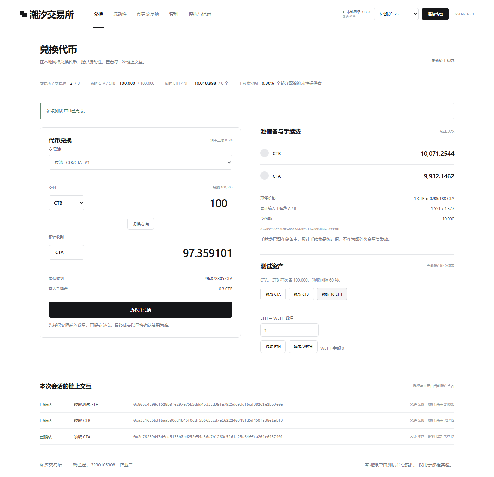

ETH 包装：

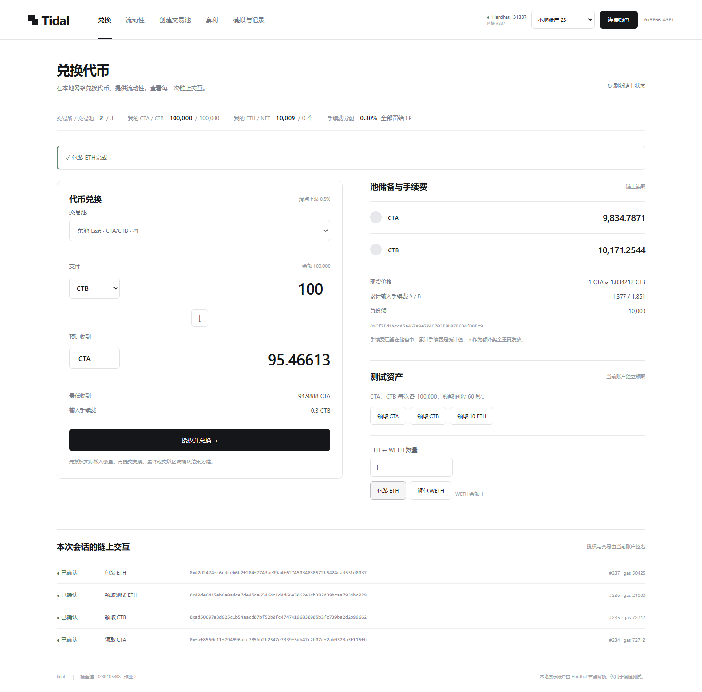

前端创建新交易池：

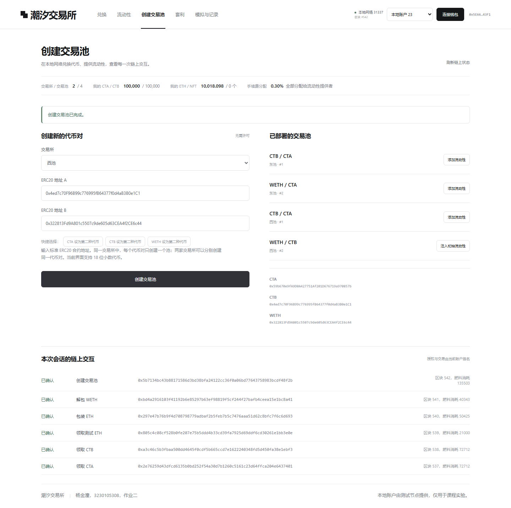

添加流动性、NFT 元数据与资金来源：

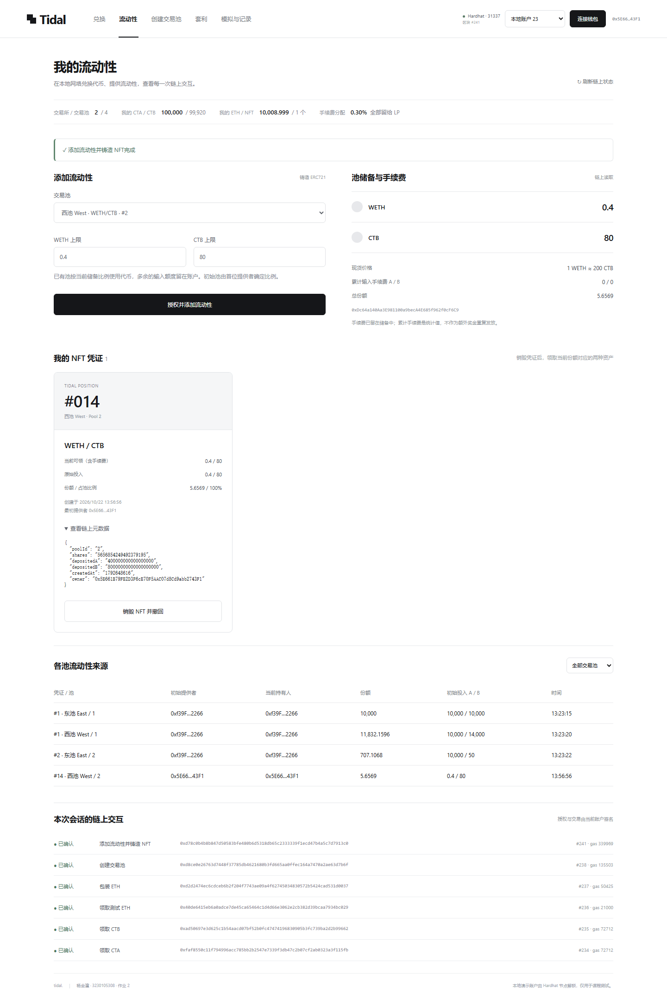

兑换及手续费变化：

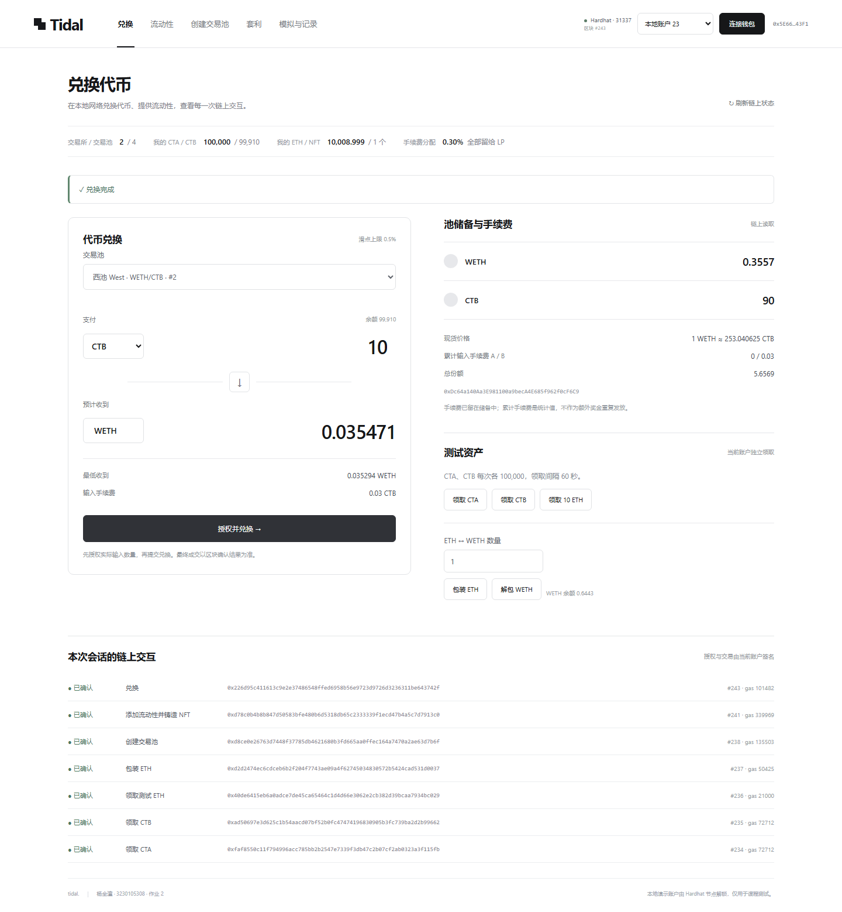

NFT 销毁和撤回：

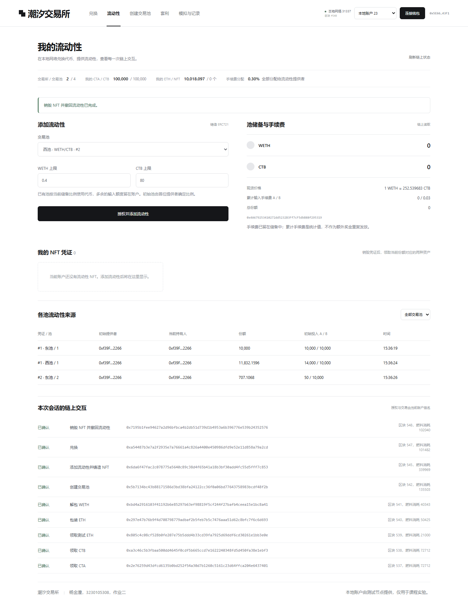

单笔套利与前后价格、储备、余额：

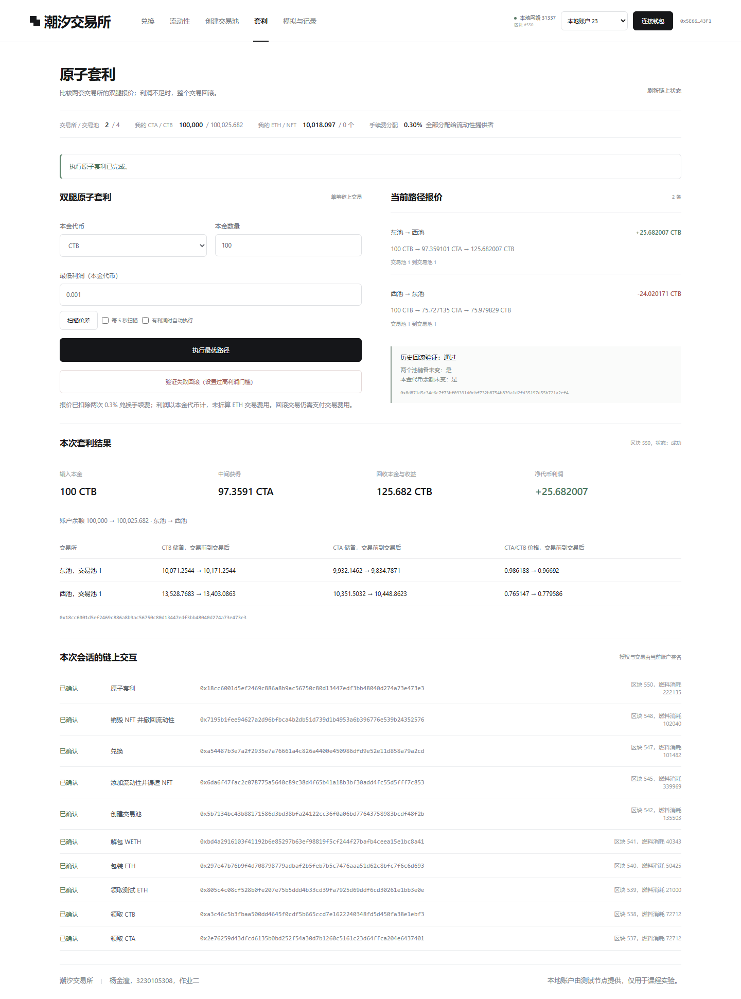

失败交易及状态回滚：

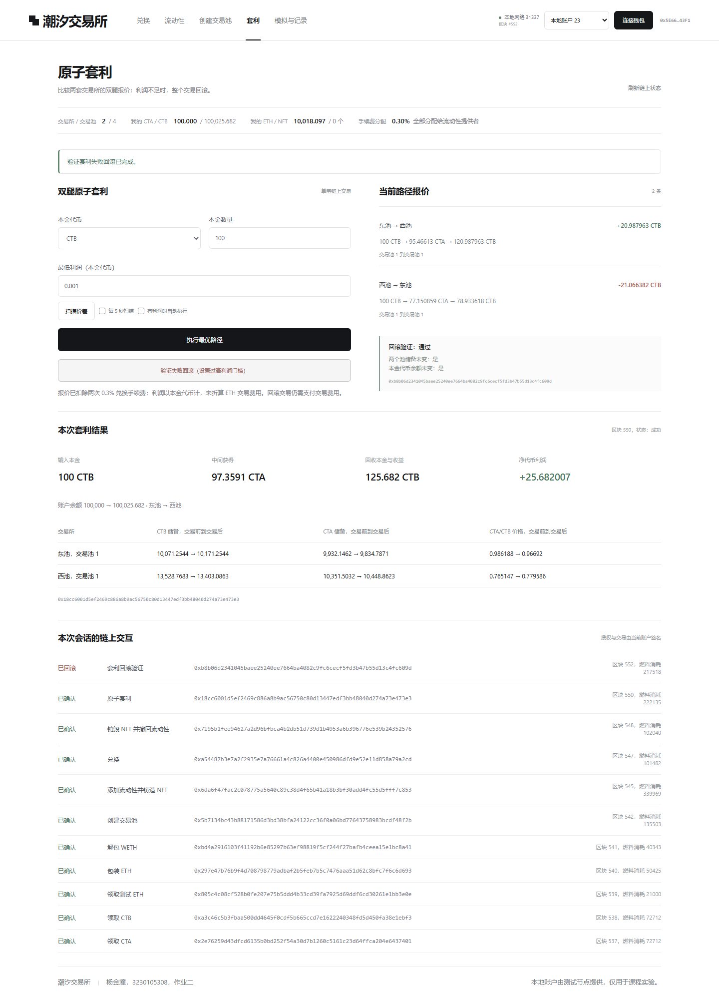

自动发现并执行套利：

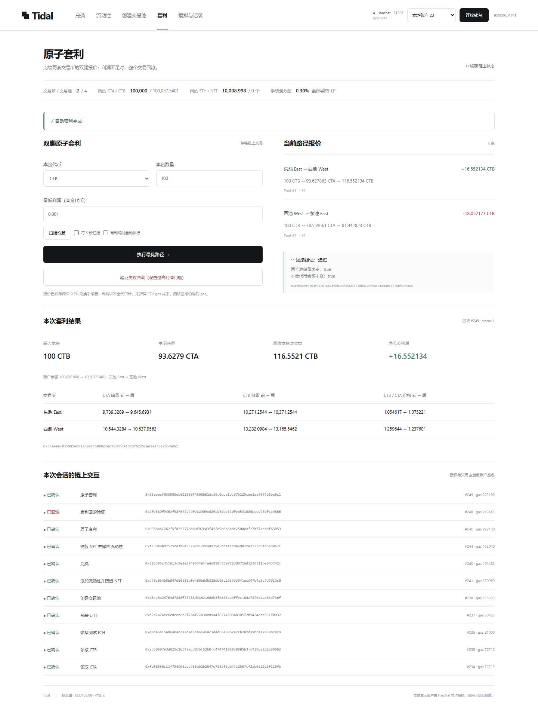

20 用户模拟及完整确认记录：

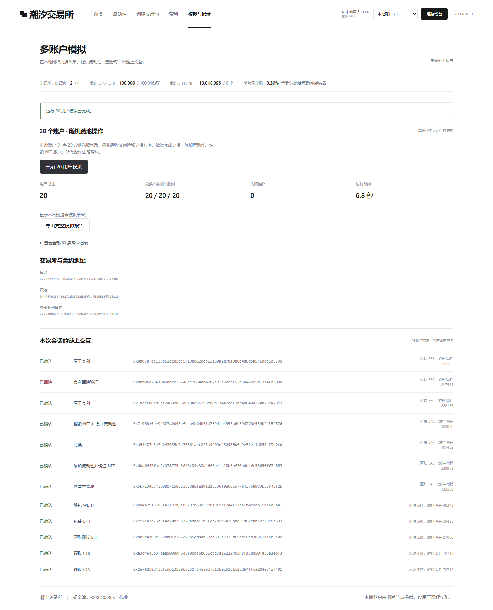
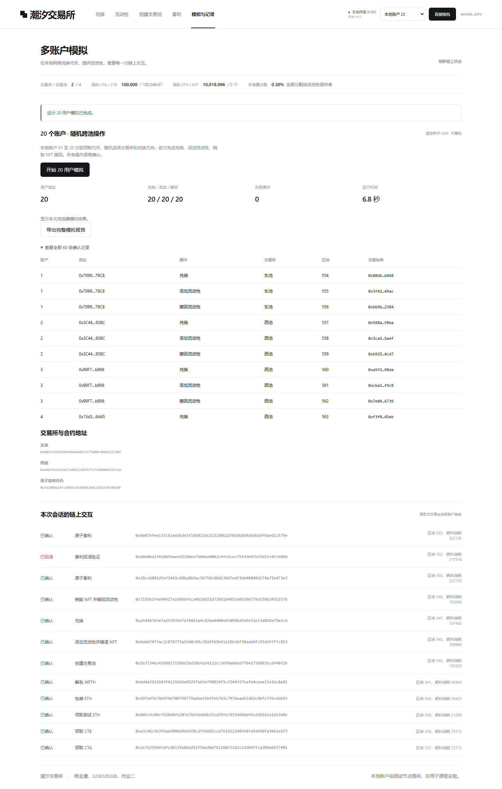

链上交互记录：

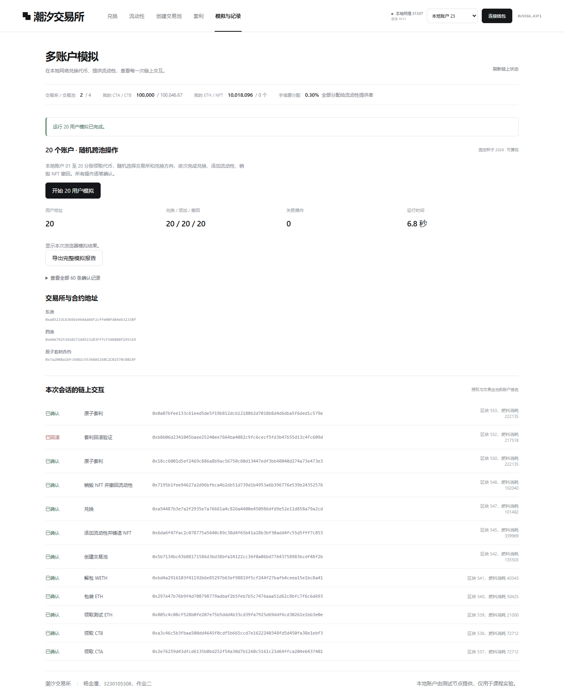

## 演示视频与提交

演示录制了从打开项目、领取测试资产，到创建池、添加流动性、兑换、销毁 NFT、套利、失败回滚和多用户模拟的操作过程。

视频和压缩提交包放在 [作业二发布页](https://github.com/kingh123132/tidal-dex-amm-arbitrage/releases/tag/assignment-2)。文件名为 `3230105308_杨金潼_作业2.mp4`，压缩包只包含视频、仓库链接和简短说明。GitHub 可能会简化下载文件名，解压后的视频保留完整的学号、姓名和作业编号。

## 目录

```text
contracts/contracts/       ERC20、WETH、DEX 与套利合约
contracts/scripts/         部署、多用户模拟、套利验证
contracts/test/            合约测试
frontend/src/              页面、交互及链上读取
frontend/src/generated/    部署生成的 ABI 与地址
scripts/                   安装与启动脚本
docs/screenshots/          实际运行截图
docs/results/              原始实验数据与回执
docs/design/               界面设计参考
.work/                     本机临时测试、录制与缓存，不提交
```

## 实现范围

本项目面向本地课程实验。支持标准、18 位小数 ERC20 的前端交互，不支持转账扣费、rebase 代币或跨链资产。资金池使用统一的 0.3% 手续费，NFT 撤回为整笔撤回。没有实现集中流动性、限价单、闪电贷和 MEV 保护。套利展示的是代币收益，实际交易还需要考虑 gas 和价格变化。

## 参考资料

- [课程框架仓库](https://github.com/LBruyne/ZJU-blockchain-course-2026)
- [Uniswap V2 核心合约](https://github.com/Uniswap/v2-core)：恒定乘积、最小流动性和份额结算的设计思路。
- [OpenZeppelin Contracts 5.4.0](https://github.com/OpenZeppelin/openzeppelin-contracts/tree/v5.4.0)：ERC20、ERC721、SafeERC20、Math、Base64、ReentrancyGuard。
- [ethers v6](https://docs.ethers.org/v6/)：JSON-RPC、合约调用、授权与回执读取。
- [Vercel Web Interface Guidelines](https://vercel.com/design/guidelines)：输入、状态反馈、响应式和键盘可访问性。
